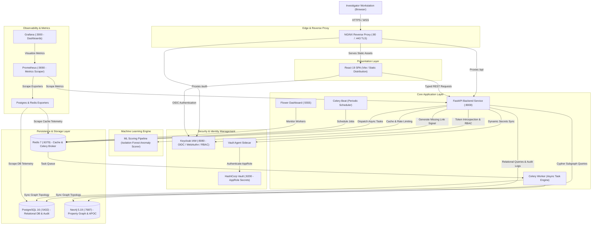

# TRACE-X — Criminal Network Analysis & Investigation Platform

TRACE-X is a specialized criminal intelligence and network analysis platform engineered to dismantle organized crime syndicates, illuminate hidden entity relationships, and facilitate cross-jurisdictional evidence sharing. Operating as a desktop-first command environment, this repository delivers the operational **Local Authority / Police Station Level** interface tailored for field investigators and Station House Officers (SHOs) to analyze case networks, file legal data requisitions, and maintain tamper-evident statutory audit trails. The **State Authority** and **Central Authority** tiers operate as architectural placeholders ("Not available in this build") representing upstream jurisdictional nodes within the planned federated intelligence framework.

---

## 1. System Architecture

The TRACE-X platform is partitioned into an edge security layer, a desktop React single-page application, an asynchronous FastAPI service mesh, dual relational/graph persistence engines, an unsupervised anomaly scoring pipeline, and a centralized monitoring harness.



---

## 2. Tech Stack

| Domain | Technology | Version | Purpose / Architecture Role |
| :--- | :--- | :--- | :--- |
| **Frontend** | React | 19.2.8 | Desktop-first reactive user interface |
| | TypeScript | 5.8+ | Strict type validation with zero-`any` policy |
| | Vite | 8.3.1 | Build tooling, HMR, and optimized production chunking |
| | Cytoscape.js | 3.34.3 | Interactive graph visualization (`cytoscape-fcose` physics layout) |
| | Lucide React | 1.48.0 | Law enforcement iconography paired with descriptive labels |
| **Backend** | FastAPI | 0.110+ | High-throughput asynchronous REST API framework |
| | Python | 3.11+ | Core runtime for backend API and ML services |
| | Uvicorn | 0.28+ | ASGI server hosting FastAPI applications |
| | Celery | 5.3+ | Asynchronous background task orchestration |
| | SQLAlchemy | 2.0+ | Object-relational mapping and database abstraction |
| | Alembic | 1.13+ | Relational schema migration management |
| **Data & Graph** | PostgreSQL | 16-alpine | Primary relational datastore, metadata registry, and audit log |
| | Neo4j Community | 5.19 | Property graph database with APOC procedures for multi-hop link analysis |
| | Redis | 7-alpine | In-memory distributed caching, query cache, and Celery message broker |
| **Machine Learning**| Scikit-learn | 1.4+ | Unsupervised Isolation Forest anomaly scoring engine |
| | Pandas & NumPy | 2.2+ / 1.26+ | Large-scale chunked matrix processing and data transformations |
| | Joblib | 1.3+ | Serialization of model weights, preprocessors, and distributions |
| **Security & IAM** | Keycloak | 24.0 | OIDC/OAuth2 identity broker, WebAuthn MFA, and fine-grained RBAC |
| | HashiCorp Vault | 1.15 | Production secrets engine with Vault Agent sidecar AppRole authentication |
| | NGINX | 1.25-alpine | Hardened reverse proxy, TLS 1.3 termination, OWASP security headers |
| **DevOps & CI** | Docker Compose | v2.26+ | Production-grade container orchestration and volume isolation |
| | GitHub Actions | - | Automated linting, type validation, ML leakage gating, and test runs |
| **Observability** | Prometheus | 2.51.0 | Real-time time-series metrics collection and alert evaluation |
| | Grafana | 10.4.0 | Interactive operational dashboards for station and infrastructure telemetry |
| | Sentry | 11.1.0 | Frontend and backend error tracing and diagnostic capture |

---

## 3. Quick Start

### (a) Frontend Only (Standalone Demo Mode)
The frontend can run independently using strongly typed local mock repositories in `src/data/mockData.ts`.

```bash
# Install dependencies
npm install

# Launch Vite development server
npm run dev
```
Open **[http://localhost:5173/](http://localhost:5173/)** in your browser.

> [!NOTE]
> When running without an active backend, fallback is permitted **only** in development (`import.meta.env.DEV`) or when `VITE_ENABLE_DEMO_MODE="true"`. Whenever mock data is being used, a persistent warning banner (`"Demo data - not real case records"`) is rendered at the top of the interface. In production builds, offline backends trigger an explicit `"Service unavailable"` error state.

---

### (b) Full Stack (Docker Compose)

#### Step 1: Copy Environment Configuration
```bash
cp .env.example .env
```

#### Step 2: Generate Local TLS Certificates
Run the certificate generation utility to establish local self-signed TLS certificates for NGINX:
```bash
# Cross-platform (Python):
python infra/nginx/certs/generate-certs.py

# Or Unix shell (Bash / OpenSSL):
bash infra/nginx/certs/generate-certs.sh
```

#### Step 3: Launch Containers
```bash
docker compose up -d --build
```

#### Step 4: Run Migrations and Seed Database
Once database healthchecks report healthy (`docker compose ps`), apply relational migrations and populate demo records:
```bash
# Execute Alembic schema migrations
docker compose exec api alembic upgrade head

# Seed PostgreSQL with police station demo records
docker compose exec api python seed.py
```

#### Step 5: Access Endpoints & Ports

| Service | Protocol / Port | URL | Description |
| :--- | :--- | :--- | :--- |
| **Application UI** | HTTPS :443 / HTTP :80 | [https://localhost](https://localhost) | Primary HTTPS reverse-proxied production interface |
| **Frontend Dev** | HTTP :5173 | [http://localhost:5173](http://localhost:5173) | Vite standalone development server with HMR |
| **Backend API** | HTTP :8000 | [http://localhost:8000/docs](http://localhost:8000/docs) | Interactive OpenAPI / Swagger documentation |
| **Keycloak IAM** | HTTP :8080 | [http://localhost:8080](http://localhost:8080) | Identity provider administration (Realm: `tracex`) |
| **Neo4j Browser** | HTTP :7474 / Bolt :7687 | [http://localhost:7474](http://localhost:7474) | Graph database query browser and visualization |
| **HashiCorp Vault**| HTTP :8200 | [http://localhost:8200](http://localhost:8200) | Secrets engine and credential storage |
| **Flower** | HTTP :5555 | [http://localhost:5555](http://localhost:5555) | Celery task monitoring and queue diagnostics |
| **Prometheus** | HTTP :9090 | [http://localhost:9090](http://localhost:9090) | Time-series metrics collection console |
| **Grafana** | HTTP :3000 | [http://localhost:3000](http://localhost:3000) | Station operational dashboards |

---

## 4. Demo Credentials

> [!WARNING]
> The credentials below are provided **exclusively for local evaluation, testing, and sandbox demonstrations**. They MUST be replaced with cryptographically random production secrets prior to deployment.

| Role / System | Identifier | Secret / Password | Permissions & Notes |
| :--- | :--- | :--- | :--- |
| **Police Investigator** | `officer_vikram` | `StationPass2026!` | Local Authority Level 2: Full case workspace, network graph, entity extraction |
| **Station Supervisor (SHO)** | `sho_rathore` | `StationPass2026!` | Local Authority Level 3: Requisition approvals, data release, full statutory audit |
| **Keycloak Admin** | `admin` | `admin_secure_2026_change_in_production` | Keycloak master realm administrator |
| **PostgreSQL** | `postgres` | `postgres_change_in_production` | Database superuser account |
| **Neo4j** | `neo4j` | `tracex_graph_2026_change_in_production` | Graph database admin (`NEO4J_AUTH`) |
| **Grafana** | `admin` | `admin_secure_2026_change_in_production` | Grafana dashboard administrator |
| **HashiCorp Vault** | `root` | `tracex-dev-root-token-change_in_production` | Vault developer root unseal token |

### How to Change Demo Credentials for Production
1. **Environment Variables**: Edit `.env` and replace all default passwords with high-entropy values generated via `openssl rand -hex 32`.
2. **Keycloak Realm**: Access the Keycloak Admin Console (`http://localhost:8080`), navigate to **Users**, update the passwords under the **Credentials** tab, or edit and re-import [realm-export.json](file:///C:/Users/Mohnish%20Sahu/OneDrive/Desktop/TRACEX-main/infra/keycloak/realm-export.json).
3. **Vault Credentials**: Initialize and unseal Vault with production recovery keys, replacing the development root token.

---

## 5. Machine Learning Honesty & Evidentiary Integrity

The machine learning engine in TRACE-X provides **decision-support anomaly signaling** for missing link prioritization. It is not an automated judicial adjudicator.

### Ground-Truth Label Audit
Analysis of the raw case corpus ([TraceX_3Million_Unique_Cases.csv](file:///C:/Users/Mohnish%20Sahu/OneDrive/Desktop/TRACEX-main/trace-x-backend/ml/data/raw)) revealed that **no organic ground-truth binary connection label** exists. The binary label `is_genuine_connection` was synthesized algorithmically using a 7-point evidentiary scoring heuristic combining case adjudication maturity, syndicated relationships, suspect roles, hard telemetry activity, and corroborating evidence artifacts.

### The Data Leakage Discovery
During empirical auditing, models trained on all 16 available features (Tier A + Tier B) achieved an artificial **1.0000 PR-AUC**. This performance was not predictive discovery; decision trees simply solved the linear arithmetic of the 7-point weak label formula. Full-feature models provide **zero incremental intelligence** and are **strictly banned from production serving**.

### Production Anomaly Scorer
- **Selected Model**: Unsupervised **Isolation Forest** (`isolation_forest.joblib`) trained exclusively on **Tier A structural features** (crime typology, temporal recency, location density, and multi-graph degree frequencies).
- **Leakage Immunity**: Because Isolation Forest operates without labels and evaluates only topological structure, it is physically incapable of formula leakage.
- **Not a Calibrated Classifier**: The model generates a continuous anomaly index between 0.0 and 1.0. It does not output a calibrated statistical probability of guilt or connection.

### Corroboration & Evidence Strength Bucketing
To protect against automated false-positive arrests, missing link candidates are mapped into human-interpretable evidence tiers requiring **concrete forensic corroboration** (at least 1 corroborating fact, such as shared vehicles, locations, or evidence seizures):

| Anomaly Score | Corroborating Graph Facts | UI Badge (`evidence_strength`) | Evidentiary Interpretation |
| :--- | :--- | :--- | :--- |
| **Score >= 0.60** | **At least 1 corroborating fact** | **`Strong`** | Model detects high structural anomaly AND forensic graph overlap confirms connection. |
| **Score >= 0.60** | **0 corroborating facts** | **`Moderate`** | Significant network structural anomaly, but lacks direct physical evidence. Capped to prevent false positives. |
| **0.35 <= Score < 0.60** | **At least 1 corroborating fact** | **`Moderate`** | Moderate structural anomaly backed by concrete forensic ties. Viable investigative lead. |
| **Score < 0.35** | **0 or more facts** | **`Limited`** | In-distribution baseline noise; prioritized lower in investigator queues. |

### Architectural Documentation References
For detailed scientific audits and implementation specs, refer to:
- [label-derivation.md](file:///C:/Users/Mohnish%20Sahu/OneDrive/Desktop/TRACEX-main/docs/label-derivation.md) — Heuristic point rubric and class balance derivation
- [leakage-audit.md](file:///C:/Users/Mohnish%20Sahu/OneDrive/Desktop/TRACEX-main/docs/leakage-audit.md) — 16-column audit isolating Tier A from Tier B features
- [feature-tiers.md](file:///C:/Users/Mohnish%20Sahu/OneDrive/Desktop/TRACEX-main/docs/feature-tiers.md) — Feature tier definitions and leakage safety invariants
- [scoring-logic.md](file:///C:/Users/Mohnish%20Sahu/OneDrive/Desktop/TRACEX-main/docs/scoring-logic.md) — Empirical benchmark tables, bucketing rules, and SHAP deviation synthesis

---

## 6. Dataset & Model Training Pipeline

The full 3,000,000-case dataset is not tracked in version control due to file size constraints.

### Dataset Placement
Obtain the raw data archive and place it at:
```
trace-x-backend/ml/data/raw/TraceX_3Million_Unique_Cases.csv
```

### Pipeline Execution Commands

```bash
# 1. Clean data, build frequency maps chunk-by-chunk, and generate stratified splits (70/15/15)
python trace-x-backend/ml/data_generation/clean_and_split.py

# 2. Partition splits into Tier A (leakage-free) and Full feature sets
python trace-x-backend/ml/data_generation/build_feature_tiers.py

# 3. Fit preprocessing transformers and serialize joblib artifacts
python trace-x-backend/ml/training/preprocessors.py

# 4. Train the production Isolation Forest anomaly scoring model
python trace-x-backend/ml/training/train_isolation_forest.py

# 5. (Optional) Train baseline diagnostic models to verify leakage dynamics
python trace-x-backend/ml/training/train_rf.py
python trace-x-backend/ml/training/train_hgb.py

# 6. Evaluate all candidate models across test splits
python trace-x-backend/ml/training/evaluate.py
```

---

## 7. Testing & Continuous Integration (CI)

### Local Verification Commands

```bash
# --- Backend Testing ---
# Run full backend pytest suite
pytest trace-x-backend/api/tests -v

# Run the mandatory Model Leakage Guard test
pytest trace-x-backend/api/tests/test_model_leakage_guard.py -v

# Run backend linting & type checks
ruff check trace-x-backend/api trace-x-backend/ml
mypy trace-x-backend/api/app --ignore-missing-imports

# --- Frontend Testing ---
# Run TypeScript type check
npx tsc --noEmit

# Run Oxlint / ESLint
npm run lint

# Run Vitest unit & integration test suite
npm test

# Build production bundle
npm run build

# --- End-to-End Playwright Testing ---
# Execute full workflow spec with demo mode enabled
cmd /c "set VITE_ENABLE_DEMO_MODE=true&& npx playwright test"   # Windows
VITE_ENABLE_DEMO_MODE=true npx playwright test                  # Linux / macOS
```

### Continuous Integration (CI) Pipeline Gates
The GitHub Actions workflow defined in [.github/workflows/ci.yml](file:///C:/Users/Mohnish%20Sahu/OneDrive/Desktop/TRACEX-main/.github/workflows/ci.yml) enforces three strict quality gates on every push and pull request:

1. **Backend CI Gate**:
   - `ruff check`: Fast Python linting across `api` and `ml`.
   - `docker compose config`: Static syntax validation of root compose configuration.
   - `mypy`: Strict static type-checking (zero errors allowed).
   - **Phase L Leakage Safety Guard (`test_model_leakage_guard.py`)**: Mandatory gate verifying that no model trained with Tier B label-derived features can be packaged for serving.
   - `pytest`: Full integration test suite run against ephemeral PostgreSQL, Neo4j, and Redis service containers.
2. **Frontend CI Gate**:
   - `oxlint`: Fast AST linting across all components and hooks.
   - `tsc --noEmit`: TypeScript strict compilation verification.
   - `vitest`: Unit and component integration tests verifying auth states, error handling, and the demo fallback banner.
   - `npm run build`: Production bundle compilation with source maps.
3. **Security Gate**:
   - `gitleaks`: Secret detection scan checking repository history against [.gitleaks.toml](file:///C:/Users/Mohnish%20Sahu/OneDrive/Desktop/TRACEX-main/.gitleaks.toml).
   - `trivy`: Container vulnerability scanner failing on any `CRITICAL` severity CVEs in the base image.

---

## 8. Project Structure, Route Map & Design System

### Directory Tree

```
TRACEX-main/
├── .github/workflows/ci.yml       # Root Continuous Integration workflow
├── .env.example                    # Master environment variable template
├── .gitleaks.toml                  # Gitleaks demo secret allowlist rules
├── docker-compose.yml              # Root production-hardened container orchestration
├── mypy.ini                        # Mypy type-checking configuration
├── ruff.toml                       # Ruff linter rules and module exclusions
├── package.json                    # Frontend package dependencies & scripts
├── vite.config.ts                  # Vite & Vitest configuration
├── playwright.config.ts            # Playwright end-to-end testing configuration
├── docs/                           # Architecture, ML audits, and security specifications
│   ├── auth-flow.md                # Keycloak OIDC authentication & WebAuthn flow
│   ├── feature-tiers.md            # Tier A vs Tier B feature specifications
│   ├── label-derivation.md         # Weak label heuristic formula documentation
│   ├── leakage-audit.md            # 16-column dataset audit preventing leakage
│   ├── scoring-logic.md            # Missing link bucketing and decision logic
│   ├── security-posture.md         # Cryptographic & network hardening posture
│   └── sync-strategy.md            # Postgres-to-Neo4j relational/graph synchronization
├── infra/                          # Infrastructure configurations
│   ├── grafana/                    # Dashboards and provisioning configs
│   ├── keycloak/                   # Realm export with users and client roles
│   ├── nginx/                      # NGINX reverse proxy config & TLS cert scripts
│   ├── prometheus/                 # Metric scraping and alert rules
│   └── vault/                      # Vault server and agent sidecar configs
├── src/                            # Frontend application source
│   ├── api/                        # Typed API client, schema types, and services
│   ├── app/                        # AppShell, router, AuthContext, DataModeContext
│   ├── components/                 # Button, DataTable, Modal, StateContainer
│   ├── core/                       # RBAC permissions and clearance validation
│   ├── data/                       # Typed synthetic mock repositories
│   ├── features/                   # Local Authority investigative feature modules
│   │   ├── auditLog/               # Statutory audit ledger with chain-of-custody
│   │   ├── cases/                  # Cases registry table and filter controls
│   │   ├── caseWorkspace/          # Case dossier, persons, and evidence lists
│   │   ├── dashboard/              # Investigation overview and metric cards
│   │   ├── dataRequests/           # Outgoing requisition workflow
│   │   ├── incomingRequest/        # Requisition adjudication & selective disclosure
│   │   ├── investigationView/      # Private sandbox investigation working view
│   │   ├── missingLink/            # AI anomaly missing link candidate review
│   │   ├── network/                # Cytoscape graph analysis and kingpin highlighting
│   │   ├── newCase/                # 5-step case filing stepper wizard
│   │   ├── personProfile/          # Person dossier, contact vectors, and risk profile
│   │   ├── persons/                # Criminal records database registry
│   │   └── receivedData/           # Inbound intelligence packages
│   └── pages/                      # Landing page, authority selection, auth callbacks
└── trace-x-backend/                # Core Python backend and ML workspace
    ├── api/                        # FastAPI application, database models, and routes
    │   ├── app/                    # FastAPI core, graph driver, models, and endpoints
    │   ├── tests/                  # Backend pytest suite & leakage safety guard
    │   ├── alembic.ini             # Alembic database migration configuration
    │   ├── Dockerfile              # Production FastAPI container specification
    │   ├── requirements.txt        # Backend Python dependency manifest
    │   └── seed.py                 # PostgreSQL database demo seeding script
    ├── migrations/                 # Alembic migration revisions
    └── ml/                         # Machine learning pipelines, models, and training
        ├── data_generation/        # Data cleaning, feature engineering, tier builders
        ├── models/v1/              # Serialized model weights (isolation_forest.joblib)
        ├── pipelines/              # Entity resolution and link prediction routines
        ├── reports/                # Evaluation reports, calibration curves, SHAP plots
        └── training/               # Model trainers (Isolation Forest, RF, HGB, evaluate)
```

### Full Route Map

```
/
├── /                             Landing Page (Animated Cytoscape background network, custom reticle cursor, clickable "X")
├── /login                        Authority Selection Tier Gate
│   ├── /login/state              State Authority Stub ("Not available in this build")
│   └── /login/central            Central Authority Stub ("Not available in this build")
│
└── [Authenticated AppShell — Protected Local Authority Area]
    ├── /dashboard                Investigation Dashboard (4 metric stat cards, requires attention list, recent cases)
    ├── /cases                    Station Cases Registry (Multi-field search, status/priority filters)
    ├── /cases/new                Create New Case (5-step stepper: Details → Upload → Extract → Review → Register)
    ├── /cases/:id                Case Workspace Dossier (Summary, metadata banner, persons, evidence, tabs)
    ├── /cases/:id/network        Network Analysis (Cytoscape graph, fcose layout, zoom/search toolbar, inspect SidePanel)
    ├── /cases/:id/missing-links  Missing Link Analysis (One candidate at a time, evidence basis list, strength badges)
    ├── /persons                  Criminal Records Registry (Master person search and risk indices)
    ├── /persons/:id              Person Profile Dossier (Contact vectors, risk level, associated cases, verified records)
    ├── /requests                 Inter-Agency Data Requests (Outgoing requisition status ledger)
    ├── /requests/new             Request Investigation Data (5-step requisition stepper with legal justification)
    ├── /incoming/:id             Incoming Data Request (Adjudication, restricted data filtering, selective disclosure)
    ├── /incoming/:id/review      Review Data Before Sending (Certification box, cryptographic transmission modal)
    ├── /received                 Received External Intelligence (Controlled isolation notice, import to view)
    ├── /views/:id                My Investigation View (Private working copy sandbox graph, node hide/expand/focus)
    └── /audit                    Station Statutory Audit Log (Immutable, cryptographically chained activity ledger)
```

### Design System Principles & Specifications
- **Strict Typography Scale**: Absolutely **no text smaller than 14px** exists anywhere in the user interface. Micro-text is strictly prohibited to guarantee operational legibility on control-room displays.
- **Color Theme**:
  - Backgrounds: `--bg-page: #F4F6F9`, `--bg-surface: #FFFFFF`
  - Brand Palette: `--primary: #1F2A6B` (deep naval blue), `--accent: #2F5FD0` (restrained operational blue)
  - Text: Primary `--text: #1E2430`, Muted `--text-muted: #5A6475`
  - Semantic Status: Success (`#1E7B4F`), Warning (`#A35B00`), Critical / Danger (`#B42318`), Neutral (`#5A6475`). Every status badge pairs iconography with an explicit text label.
- **Evidentiary Source Linage Badges**:
  - Every intelligence fact in the user interface carries an explicit source badge: `VERIFIED RECORD` (formal law enforcement filings), `SYSTEM-DERIVED` (cross-referenced relational telemetry), or `AI ANALYSIS` (machine-generated decision-support anomaly leads).
- **Accessibility & Motion Compliance**:
  - WCAG AA contrast ratios validated across light surfaces.
  - Prominent 3px accent focus rings with 2px offset on all focusable elements.
  - Full keyboard accessibility, modal focus trapping, and Esc key dismissal.
  - Respects `prefers-reduced-motion: reduce` by freezing canvas animations and disabling transitions.

---

## 9. Academic Project Notice

> [!NOTE]
> **Academic & Research Project Notice**: This software repository was designed and developed strictly for academic, educational, and research purposes in the fields of criminal network topology analysis, data leakage prevention, and secure law enforcement human-in-the-loop decision-support systems. No commercial license or operational warranty is implied or granted.
